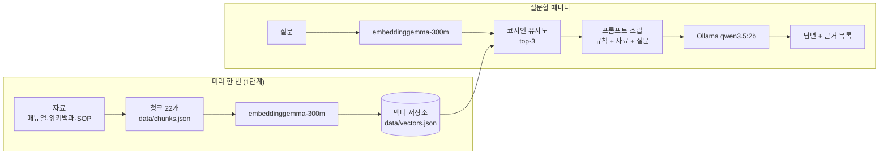

# Pro Tools 사용법 안내 챗봇 (로컬 RAG)

Pro Tools로 음악·음향 작업을 하는 사람이 궁금한 게 생길 때마다 매뉴얼을 뒤져야 하는 불편을 줄이려고 만든 챗봇입니다.
질문하면 **Avid 공식 매뉴얼, 위키백과 공개 문서, 교육용 작업 SOP**에서 관련 조각을 찾아 그 근거로 답합니다.
모든 것이 내 PC(Mac)에서 돌아갑니다. 서버, 배포, 웹 화면은 없습니다.

## 1. 소개

| 답하는 것 | 답하지 않는 것 |
|---|---|
| Pro Tools 녹음 준비, 편집, 바운스와 익스포트, 단축키 | Pro Tools 세션의 실시간 정보(BPM 등) 조회·조작 |
| 오디오 기본 개념(레이턴시, 샘플링 레이트, 비트 심도 등) | 플러그인 추천, 구매·라이선스 상담 |
| 작업 SOP(세션 생성, 녹음 전 체크, 납품 바운스 규칙) | 다른 DAW 사용법 |

자료에 근거가 없으면 "관련 자료를 찾지 못했습니다", 범위 밖 질문에는 "이 챗봇은 Pro Tools 사용법만 안내합니다"라고 답하도록 했습니다.

## 2. 동작 원리



1. 자료를 사실 하나 단위의 청크로 잘라 `data/chunks.json`에 저장합니다.
2. 청크마다 임베딩 모델로 768개 숫자(벡터)를 만들어 `data/vectors.json`에 저장합니다.
3. 질문도 같은 모델로 벡터로 바꾸고, 모든 청크와 코사인 유사도를 계산해 가장 비슷한 3개를 고릅니다(1단계).
4. 고른 청크와 질문, 답변 규칙을 하나의 프롬프트로 조립해 로컬 LLM에 보냅니다.
5. LLM이 자료에 근거해 답하고, 프로그램이 LLM에게 넘긴 자료 목록을 근거로 함께 보여 줍니다(2단계).

## 3. 사용 기술

| 항목 | 내용 |
|---|---|
| 실행 환경 | Node.js (ES 모듈), Mac 터미널 |
| 임베딩 | transformers.js(`@huggingface/transformers`), `onnx-community/embeddinggemma-300m-ONNX`, dtype `q8`, mean pooling + 정규화, 768차원 |
| 임베딩 입력 형식 | 문서 `title: 섹션 \| text: 본문`, 질문 `task: search result \| query: 질문` (모델 공식 형식) |
| LLM | Ollama `qwen3.5:2b`, `temperature: 0`, 스트리밍 |
| 약한 근거 기준 | 1위 점수 0.55 미만이면 ⚠ |

## 4. 실행 방법

준비 (한 번만):
```bash
ollama pull qwen3.5:2b
```
```bash
npm install
```

벡터 저장소 만들기 (청크를 바꿀 때마다 다시 실행):
```bash
node src/build-index.mjs
```

1단계: 비슷한 자료 찾기
```bash
node src/search.mjs "페이드 인은 어떻게 만들어?"
```

2단계: 자료에 근거한 답변 받기
```bash
node src/ask.mjs "페이드 인은 어떻게 만들어?"
```

| 옵션 | 설명 |
|---|---|
| `--k 5` | 검색 결과 개수 (기본 3) |
| `--show-prompt` | LLM을 부르지 않고, 조립된 system/user 프롬프트만 출력 |
| `--no-rag` | 검색 없이 질문만 LLM에 보냄 (비교 실험용) |

## 5. 자료

공식 매뉴얼은 [Avid Knowledge Base의 Pro Tools Documentation](https://kb.avid.com/pkb/articles/en_US/user_guide/Pro-Tools-Documentation)에서 받은 Pro Tools Reference Guide 2026.4와 Shortcuts Guide 2025.10입니다. PDF는 용량이 커서 git에 올리지 않았습니다(`manuals/`).

| id | section | 출처 |
|---|---|---|
| PT-001 | 녹음 준비: Playback Engine (2026.4) | [링크](https://resources.avid.com/SupportFiles/PT/Pro_Tools_Reference_Guide_2026.4.pdf#page=210) |
| PT-002 | 녹음 준비: 하드웨어 버퍼 크기 낮추기 (2026.4) | [링크](https://resources.avid.com/SupportFiles/PT/Pro_Tools_Reference_Guide_2026.4.pdf#page=220) |
| PT-003 | 녹음 준비: 오디오 트랙 녹음 기본 순서 (2026.4) | [링크](https://resources.avid.com/SupportFiles/PT/Pro_Tools_Reference_Guide_2026.4.pdf#page=875) |
| PT-004 | 편집: 네 가지 Edit 모드 (2026.4) | [링크](https://resources.avid.com/SupportFiles/PT/Pro_Tools_Reference_Guide_2026.4.pdf#page=959) |
| PT-005 | 편집: Shuffle 모드 (2026.4) | [링크](https://resources.avid.com/SupportFiles/PT/Pro_Tools_Reference_Guide_2026.4.pdf#page=959) |
| PT-006 | 편집: Slip 모드 (2026.4) | [링크](https://resources.avid.com/SupportFiles/PT/Pro_Tools_Reference_Guide_2026.4.pdf#page=960) |
| PT-007 | 편집: Spot 모드와 Grid 모드 (2026.4) | [링크](https://resources.avid.com/SupportFiles/PT/Pro_Tools_Reference_Guide_2026.4.pdf#page=960) |
| PT-008 | 편집: 페이드 인 만들기 (2026.4) | [링크](https://resources.avid.com/SupportFiles/PT/Pro_Tools_Reference_Guide_2026.4.pdf#page=1039) |
| PT-009 | 바운스와 익스포트: 최종 믹스 바운스 순서 (2026.4) | [링크](https://resources.avid.com/SupportFiles/PT/Pro_Tools_Reference_Guide_2026.4.pdf#page=1731) |
| PT-010 | 바운스와 익스포트: 클립을 파일로 내보내기 (2026.4) | [링크](https://resources.avid.com/SupportFiles/PT/Pro_Tools_Reference_Guide_2026.4.pdf#page=751) |
| PT-011 | 단축키: 재생과 녹음 (2025.10) | [링크](https://resources.avid.com/SupportFiles/PT/Pro_Tools_Shortcuts_2025.10.pdf#page=27) |
| PT-012 | 단축키: 저장, 바운스, 편집 메뉴 (2025.10) | [링크](https://resources.avid.com/SupportFiles/PT/Pro_Tools_Shortcuts_2025.10.pdf#page=52) |
| PT-013 | 위키백과: 프로 툴스 개요 | [링크](https://ko.wikipedia.org/wiki/%ED%94%84%EB%A1%9C_%ED%88%B4%EC%8A%A4) |
| PT-014 | 위키백과: 프로 툴스 지원 오디오 형식 | [링크](https://ko.wikipedia.org/wiki/%ED%94%84%EB%A1%9C_%ED%88%B4%EC%8A%A4) |
| PT-015 | 위키백과: 오디오 레이턴시 | [링크](https://ko.wikipedia.org/wiki/%EB%A0%88%EC%9D%B4%ED%84%B4%EC%8B%9C_%28%EC%98%A4%EB%94%94%EC%98%A4%29) |
| PT-016 | 위키백과: 샘플링 레이트 | [링크](https://ko.wikipedia.org/wiki/%EC%83%98%ED%94%8C%EB%A7%81_%EC%86%8D%EB%8F%84) |
| PT-017 | 위키백과: 오디오 비트 심도 | [링크](https://ko.wikipedia.org/wiki/%EC%98%A4%EB%94%94%EC%98%A4_%EB%B9%84%ED%8A%B8_%EC%8B%AC%EB%8F%84) |
| PT-018 | 위키백과: 오디오 인터페이스 | [링크](https://ko.wikipedia.org/wiki/%EC%98%A4%EB%94%94%EC%98%A4_%EC%9D%B8%ED%84%B0%ED%8E%98%EC%9D%B4%EC%8A%A4) |
| PT-019 | 위키백과: 오디오 믹싱 | [링크](https://ko.wikipedia.org/wiki/%EC%98%A4%EB%94%94%EC%98%A4_%EB%AF%B9%EC%8B%B1) |
| PT-020 | SOP: 세션 생성 규칙 | [docs/sop.md](docs/sop.md#세션-생성-규칙) |
| PT-021 | SOP: 녹음 전 체크리스트 | [docs/sop.md](docs/sop.md#녹음-전-체크리스트) |
| PT-022 | SOP: 납품 바운스 규칙 | [docs/sop.md](docs/sop.md#납품-바운스-규칙) |

**청크 설계 원칙**
1. 한 청크에 사실 하나. 주제가 섞이면 엉뚱한 질문에도 걸립니다.
2. 혼자 읽어도 뜻이 통하게. "그것은…"처럼 앞 문맥이 필요한 문장은 쓰지 않습니다.
3. 원문에 없는 말을 보태지 않습니다. (작성 중 "상황에 맞게 조정한다"는 해석 문장을 발견해 지웠습니다.)

**청크 수가 과제 기준(12~15개)보다 많은 이유**: 처음에는 매뉴얼만으로 15개를 만들었습니다. 하지만 LLM이 모르는 "우리만의 규칙"이 있어야 RAG의 효과가 잘 드러나서 SOP 3개를 더했습니다. 또 오디오 기본 개념 질문에 답할 수 있도록 위키백과 7개를 넣었습니다. 매뉴얼 청크를 더 줄이면 4개 주제를 다루기 어려워서 22개를 유지했습니다.

## 6. 1단계 관찰 기록

`node src/search.mjs`로 측정한 1위 점수입니다(22청크, q8).

| # | 질문 | 유형 | 1위 청크 | 점수 | 관찰 |
|---|---|---|---|---|---|
| 1 | 페이드 인은 어떻게 만들어? | 정상 | PT-008 페이드 인 만들기 | 0.702 | 정확함. 2위는 0.479로 뚝 떨어짐 |
| 2 | 소리가 점점 커지게 시작하려면? | 다른 표현 | PT-021 SOP: 녹음 전 체크리스트 | 0.596 | "페이드" 없이 물으면 1위를 놓침. 정답 PT-008은 2위(0.573) |
| 3 | Slip 모드가 뭐야? | 정상 | PT-006 Slip 모드 | 0.734 | |
| 4 | Shuffle 모드랑 Slip 모드 차이 | 경계 | PT-005 Shuffle 모드 | 0.717 | 2위 Slip 모드(0.681). 답에 두 청크가 필요 |
| 5 | 녹음할 때 입력 레벨은 얼마로 맞춰? | 정상 | PT-003 녹음 기본 순서 | 0.722 | 2위 SOP(0.672). 매뉴얼과 SOP 둘 다 근거 |
| 6 | 우리 세션은 샘플 레이트를 뭘로 만들어? | SOP | PT-020 SOP: 세션 생성 규칙 | 0.653 | "우리" 규칙을 SOP에서 찾음 |
| 7 | 내 세션 지금 몇 BPM이야? | 도메인 밖 | PT-020 SOP: 세션 생성 규칙 | 0.619 | 기준(0.55)을 넘어 ⚠가 안 뜸. "세션"이라는 단어에 끌림 |
| 8 | 로직 프로에서 오토메이션 하는 법 | 도메인 밖 | PT-009 바운스 순서 | 0.576 | 기준을 넘어 ⚠가 안 뜸. 1~3위가 0.56~0.58로 평평함 |
| 9 | 내일 날씨 어때? | 무관 | PT-020 | 0.423 | ⚠ |
| 10 | 김치찌개 레시피 알려줘 | 무관 | PT-003 | 0.402 | ⚠ |

**생각해 볼 것**
1. *단어가 겹치지 않아도 찾을 수 있는 이유는?* 임베딩이 단어가 아니라 뜻을 비교하기 때문입니다. 다만 2번처럼 완벽하지는 않아서, 정답을 2위까지만 끌어올리고 1위는 놓쳤습니다. 청크가 "페이드"라는 용어 위주로 쓰여 있어서 그런 것으로 보입니다.
2. *무관한 질문에도 1위가 나오는 이유는?* 검색은 "가장 가까운 것"을 고를 뿐, "답이 있는지"는 모릅니다. 날씨, 요리 질문도 1위 청크가 나왔고, 점수(0.40~0.42)로만 걸러졌습니다. 그래서 기준 점수가 필요합니다.
3. *점수 기준만으로 충분한가?* 아닙니다. 7, 8번처럼 Pro Tools 단어가 섞인 도메인 밖 질문은 0.58~0.62로, 진짜 질문인 2번(0.596)보다 높았습니다. 기준을 올려도 둘을 가를 수 없어서 0.55를 유지했습니다. 대신 2단계에서 LLM에게 "범위 밖이면 Pro Tools 사용법만 안내한다"는 규칙을 줬습니다. 이것이 검색만으로는 부족하고 생성 단계가 필요한 이유입니다.

## 7. 2단계 비교 실험 기록

같은 질문을 `--no-rag`와 RAG로 각각 실행했습니다.

| 질문 | RAG 없이 (핵심) | RAG (핵심) | ID 표시 | 지어낸 내용? |
|---|---|---|---|---|
| 녹음할 때 지연이 생기면 버퍼를 어떻게 바꿔? | 버퍼를 "2~3배 늘려라", 샘플 레이트를 22.05kHz로 낮춰라, 존재하지 않는 `Real-time Processing` 메뉴 (40.5초) | Playback Engine의 Hardware Buffer Size를 낮추면 지연이 개선됨 (5.2초) | ✓ PT-002 | RAG 없이: 매뉴얼과 정반대 조언, 지어낸 메뉴 / RAG: 없음 |
| 우리 납품 파일 이름 규칙이 뭐야? | `[프로젝트명]-[제품명/코드]-[버전]_[날짜]` 형식을 지어냄 (10.4초) | `곡명_Mix_v번호_YYMMDD`, 수정본마다 v 번호를 올림 (6.6초) | ✓ PT-022 | RAG 없이: 전부 지어냄 / RAG: 없음 |
| 내 세션 지금 몇 BPM이야? | BPM을 심박수로 이해하고 스마트워치를 추천 (9.4초) | 현재 시각을 말한 뒤 "BPM 정보는 제공되지 않습니다. 관련 자료를 찾지 못했습니다" (3.6초) | 없음 | 둘 다 숫자는 지어내지 않음. RAG는 범위 밖 안내 문장을 빠뜨림 |
| 로직 프로에서 오토메이션 하는 법 | 로직 프로 사용법을 길게 설명. "노드 오버레이", "Label" 등 실제와 다른 메뉴 (58.3초) | "자료에 해당 정보가 없습니다. [관련 자료를 찾지 못했습니다]" (3.8초) | 없음 | RAG 없이: 지어낸 메뉴 / RAG: 없음. 다만 "Pro Tools 사용법만 안내" 문장이 빠짐 |
| 내일 날씨 어때? | | ⚠ 약한 근거 → "관련 자료를 찾지 못했습니다." (2.4초) | 없음 | 없음 |

**읽는 법**
- RAG가 환각을 크게 줄였습니다. 특히 버퍼 질문에서 RAG 없이는 매뉴얼과 정반대로 답했습니다.
- "우리" 규칙(SOP)은 LLM이 알 수 없어서, RAG 없이는 그럴듯하게 지어냈습니다.
- RAG로 답이 짧고 빨라졌습니다(10~58초 → 2~7초).
- 2B 모델은 시스템 메시지의 규칙을 다 지키지 못했습니다. "단계별 설명", "용어명과 설명 함께", "Pro Tools 사용법만 안내합니다" 문장이 자주 빠졌고, 출처 ID를 문장 끝이 아니라 답 맨 끝에 붙이기도 했습니다. 그래도 "지어내지 않기"는 대부분 지켰습니다.
- `temperature: 0`이어도 긴 답은 실행마다 뒷부분이 조금 달라졌습니다. 시각이 들어가지 않는 `--no-rag`에서도 그랬습니다.

**한 가지만 바꿔 보기: 시각 문장**
BPM 질문에서 모델이 현재 시각을 말하는 문제를 고치려고, 프롬프트 ④ 끝에 "시각은 질문에 날짜·시간 표현이 있을 때만 사용하고, 답에서 따로 말하지 않습니다."를 추가해 봤습니다.
- 결과: BPM 질문은 여전히 시각을 말했고, 오히려 "BPM은 세션 생성 시 설정된 속도로 저장되며…"라는 근거 없는 내용을 지어냈습니다. 로직 프로 질문에도 근거 없는 문장이 생겼습니다.
- 해석: "말하지 마라"는 부정 지시가 오히려 그 내용을 강조했고, 한 줄만 바꿔도 다른 규칙까지 흔들렸습니다. 결과가 나빠져서 되돌렸습니다.

## 8. 한계와 다음 단계

**한계**
- 2B 모델은 규칙이 많으면 일부를 놓칩니다(단계별 설명, 범위 밖 안내 문장, ID 위치).
- 검색 점수만으로는 "자료에 답이 없음"을 판단하기 어렵습니다. Pro Tools 단어가 섞인 도메인 밖 질문이 기준을 통과합니다.
- 청크가 22개뿐이라 오토메이션, 믹싱 플러그인 같은 주제는 답할 수 없습니다.
- SOP는 교육용 예시입니다.

**다음에 해 볼 것**
- 단어 검색(BM25)을 섞은 하이브리드 검색: 메뉴 이름이나 단축키처럼 글자가 정확해야 하는 질문 보완
- 시스템 메시지 규칙을 줄이거나 긍정문으로 바꿔서 지키는 비율 비교
- 매뉴얼 청크 확대(오토메이션, 믹싱) 후 STEP 5 질문 다시 실행
- 더 큰 모델과 비교
